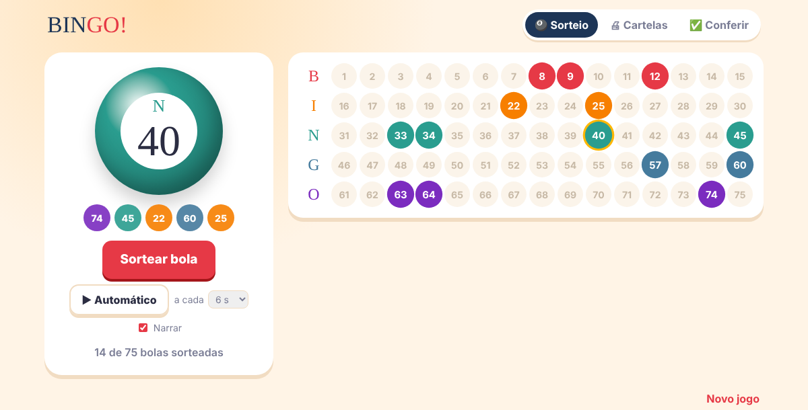

# BingoCard — Cartelas e sorteador de bingo

Gere cartelas de bingo para imprimir, sorteie as bolas com narração e confira as cartelas vencedoras pelo código.

🔗 **[Ver o site no ar](https://iamviniciuslima05.github.io/PROJETO-BingoCard/)**



## Funcionalidades

- **Sorteador** de 75 bolas com animação, painel e últimas bolas
- **Narração** em voz alta com apelidos tradicionais
- Modo **automático** a cada 4, 6 ou 10 segundos
- **Cartelas** com título, cor e prêmio, prontas para **imprimir** (1 a 6 por folha)
- Cada cartela tem um **código**: dá para **conferir** linha, coluna, diagonal ou cartela cheia
- Mostra o que falta para fechar a linha mais próxima

## Tecnologias

HTML5 · CSS3 · JavaScript · Web Speech API · CSS de impressão · localStorage

## Estrutura

```
index.html
css/style.css
js/script.js
```

## Como rodar

Não precisa instalar nada: baixe o projeto e abra o `index.html` no navegador, ou acesse a versão publicada acima.

---
Feito por **Vinicius Lima** · [Portfólio](https://viniciuslimadev.netlify.app) · [LinkedIn](https://www.linkedin.com/in/viniciuslima25/)
